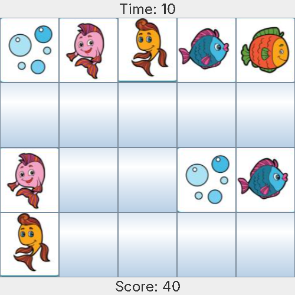

# 🃏 Flip-Match Card Game

A Java memory game: flip the cards, find the matching pairs and beat the clock.

> Built with **Java Swing**. This game is also Level 1 of [SmartMe](https://github.com/RenadQ/smartMe), a two-level memory app.

<p align="center">
  
</p>

## 🎮 How to play

1. The board shows **20 face-down cards** (10 pairs).
2. Click a card to flip it, then click a second card.
3. If the two cards match, they stay face up and you earn **10 points**.
4. If they don't match, they flip back after a second.
5. Find every pair within **80 seconds** to win. When the game ends, you can play again or exit.

## ✨ Features

- Shuffled card images every game
- Live **timer** and **score**
- Short delay before unmatched cards flip back, so you can memorize them
- Game-over dialog showing your time and score, with a **Play again** option

## 🧩 How it works

| Part | Role |
|---|---|
| `FlipMatchCardGame` (extends `JFrame`) | Builds the window: card grid, timer label and score label |
| `CardButtonListener` | Handles clicks: reveals a card, compares the pair, and keeps or hides the cards |
| `resetGame()` | Shuffles the images, hides all cards and restarts the timer |
| `updateTimer()` / `updateScore()` | Update the labels and end the game on timeout or full score |
| `showGameOver()` | Shows the result and asks to play again or exit |

## ▶️ How to run

Requires Java 8 or newer. Run from the project root, because the game loads its card images from [`assets/`](assets):

```bash
javac -d out src/flipmatchcardgame/FlipMatchCardGame.java
java -cp out flipmatchcardgame.FlipMatchCardGame
```

## 📁 Project structure

```
.
├── src/flipmatchcardgame/FlipMatchCardGame.java   # The whole game
├── assets/pic1.png … pic10.png                    # Card images
└── docs/gameplay.png
```

---

<details>
<summary>🇸🇦 ملخص بالعربي</summary>

لعبة ذاكرة بلغة Java: تقلب البطاقات وتدور على الأزواج المتطابقة قبل ما يخلص الوقت (٨٠ ثانية). كل زوج صحيح يعطيك ١٠ نقاط. اللعبة نفسها هي المستوى الأول في مشروع SmartMe.
</details>
